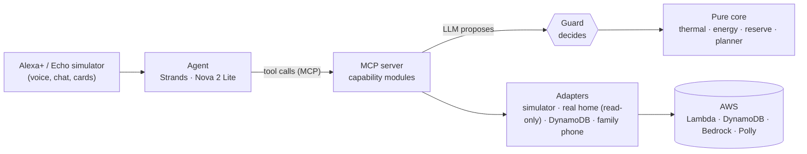

# Cold Reserve (working name)

When the heat comes or the power goes out, someone at home needs one room that stays safe: a grandparent, a baby, a person who works from home. Cold Reserve is a voice assistant that spends a home battery on that room first, says in plain words how many hours of comfort are left, and lets a set of deterministic checks, not the language model, decide what is allowed.

Built for the Amazon "Build, Ship, Shape" hackathon, Alexa+ track: an MCP server (spec 2025-11-25, Streamable HTTP), a web simulator of the Alexa+ experience, and an agent that talks to the server.

> **Honesty box.** Everything below describes what is merged on `main`.
> - **The demo home is simulated.** A seeded physics simulator (`packages/adapters/source-simulator`, scenarios `clear-day`, `heatwave`, `storm-blackout`) stands in for the house; its clock is anchored by config (`MCP_SCENARIO_ANCHOR`), so every Lambda instance replays the same moment ([scenario-anchor.test.ts](apps/mcp-server/test/scenario-anchor.test.ts)). Every number carries its origin, and the screen shows a **SIMULATED** badge next to it ([OriginBadge.tsx](apps/alexa-sim/src/ui/OriginBadge.tsx)).
> - **The storm is a scenario.** No real blackout is involved; the family messages go to a simulated in-app phone: an inbox kept in the home's state store for two days ([notifier-inapp](packages/adapters/notifier-inapp/src/index.ts), [state-store.ts:44](packages/core/src/state-store.ts:44)), not to real phones.
> - **The real home is read-only.** The `home` id is served by the simulator until the home bridge exists ([app.ts:43](apps/mcp-server/src/app.ts:43), issue #15), and on it a plan is advice with manual steps, never a command ([docs/comfort-plan.md](docs/comfort-plan.md)).
> - **The model is fake until AWS.** Locally and in CI the agent runs on a scripted fake model; Bedrock (Nova 2 Lite) is wired in config but not called yet ([config.ts:24](apps/agent/src/config.ts:24)).
> - **Not done yet:** the sim-api HTTP entry (#101), real voice (#25), the storm screen and family phone screen (#24), the card bundle on Lambda (#104), the database error log, and the deploy. See [What is not done yet](#what-is-not-done-yet).

## What it does today

### Home status
- **You ask:** "What's my battery level?"
- **Tool:** `get_home_status` ([energy-status](apps/mcp-server/src/modules/energy-status/index.ts)). Returns battery, solar, load and grid, the pacing level and why, whether the splits can be driven, each room (served or waiting, with the reason), and where every group of data comes from.
- **Guarantee:** the origin (`live` / `simulated`) travels with the data; the summary the model reads says "simulated data" when it is ([index.ts:25](apps/mcp-server/src/modules/energy-status/index.ts:25)).
- **Proof:** [e2e/energy-status.test.ts](apps/mcp-server/test/e2e/energy-status.test.ts), demo scene 1 [scene-01-battery-level.spec.ts](e2e/demo-script/scene-01-battery-level.spec.ts).

### Comfort plan, guard and confirmation
- **You ask:** "It's going to be 36 degrees tomorrow, keep Grandpa cool." You see a plan card: the level ladder over time, the reserve line and the guard's receipt. You confirm, then it is applied.
- **Tools:** `plan_comfort` (read-only on the home) proposes; `apply_plan` applies by `planId` after you confirm ([comfort-plan](apps/mcp-server/src/modules/comfort-plan/index.ts), [docs/comfort-plan.md](docs/comfort-plan.md)).
- **Guarantees:** "the model proposes, the guard decides" ([docs/guard.md](docs/guard.md)). Every plan is checked against five guarantees, all of them every time: `storm_reserve`, `inverter_limit`, `battery_power`, `safe_room_comfort`, `pacing_on_track` ([guarantees.ts](packages/contracts/src/guarantees.ts)). A refusal says which one failed and the nearest allowed value. `apply_plan` re-checks the plan on the current state, applies it at most once, and refuses a plan built on simulated data for the real home.
- **Proof:** [plan-comfort.test.ts](apps/mcp-server/test/comfort-plan/plan-comfort.test.ts), [apply-plan.test.ts](apps/mcp-server/test/comfort-plan/apply-plan.test.ts), property tests with 10 000 cases ([guard.property.test.ts](packages/guard/test/guard.property.test.ts)), MCP flow [hot-day.test.ts](apps/mcp-server/test/e2e/hot-day.test.ts), demo scene 2 [scene-02-hot-day.spec.ts](e2e/demo-script/scene-02-hot-day.spec.ts).

### Night recovery
- **What it means:** the safe room must stay cool enough to sleep between 22:00 and 07:00: at or below 26 °C (CIBSE TM59), or 24 °C when an elderly person is in it. It is a comfort-for-sleep measure, not a medical claim.
- **Where:** `nightRecovery` in every plan ([plan.ts:67](packages/contracts/src/plan.ts:67)), computed by the guard ([night.ts](packages/guard/src/night.ts)).
- **Guarantee:** a plan that misses the night when a simple strategy could meet it is refused (`night_recovery_unmet`). When nothing can meet it, the plan says so honestly (`infeasible`, with the best achievable hours) instead of failing silently.
- **Dry or cool by humidity:** on its own plans in the cooling season, the planner picks dry or cool for the safe room step by step from the projected humidity: dry above 55 %, cool again below 45 %, no flipping inside the band, always inside the person's humidity limits (config `planner.humidityBand`, [docs/comfort-plan.md](docs/comfort-plan.md)). One mode for the whole night fails both ways: cooling lets humid night air push the room above 60 %, drying takes it below 40 %. Humidity the plan cannot raise is reported as dry air, with a warning, instead of refusing the plan ([dry-air.ts](packages/guard/src/dry-air.ts)). A plan the model proposes is left as it is.
- **Proof:** [night.test.ts](packages/core/test/night.test.ts), night properties in [guard.property.test.ts](packages/guard/test/guard.property.test.ts), humidity in [plan-comfort.test.ts:96](apps/mcp-server/test/comfort-plan/plan-comfort.test.ts:96) and the property test at line 130.

### Counterfactual: "without the plan"
- **What it means:** next to our plan, the same hours projected with no plan and with the naive "AC until the battery dies", so the voice can say how hot the safe room would get without it.
- **Where:** `counterfactual` in the plan ([counterfactual.ts](packages/contracts/src/counterfactual.ts), [core/counterfactual.ts](packages/core/src/counterfactual.ts)). It is in the data the model reads; the plan card does not draw it yet.
- **Proof:** [plan-comfort.test.ts:28](apps/mcp-server/test/comfort-plan/plan-comfort.test.ts:28), [hot-day.test.ts:109](apps/mcp-server/test/e2e/hot-day.test.ts:109).

### Reserve "ice cubes"
- **You ask:** "How long will the battery last?" You see the battery counted in hours: at the current level, at Essential, and from the storm reserve alone.
- **Tool and card:** `get_reserve_outlook` ([comfort-plan](apps/mcp-server/src/modules/comfort-plan/index.ts)) and [IceCubesCard.tsx](packages/ui-cards/src/IceCubesCard.tsx). The storm look appears only when the grid is measured down.
- **Proof:** [reserve-outlook.test.ts](apps/mcp-server/test/comfort-plan/reserve-outlook.test.ts), [ice-cubes.test.tsx](packages/ui-cards/test/ice-cubes.test.tsx).

### Preferences
- **You ask:** "Show my preferences." You see the preferences card; a change is saved only after you confirm it.
- **Tools:** `get_preferences`, `set_preferences` ([preferences.ts](apps/mcp-server/src/modules/preferences.ts)).
- **Guarantees:** safety thresholds move only inside hard limits from config; `set_preferences` is marked destructive so the host asks for confirmation, and needs `confirmed: true`; every change is logged. Contacts are shown by role only: names never reach the model.
- **Proof:** [preferences-module.test.ts](apps/mcp-server/test/preferences-module.test.ts), [e2e/preferences.test.ts](apps/mcp-server/test/e2e/preferences.test.ts), [preferences-card.test.tsx](packages/ui-cards/test/preferences-card.test.tsx).

### Storm mode, safe hours and family messages
- **You ask:** "A storm is coming tonight." The assistant prepares; if the grid goes down, storm mode becomes active and tells you how many hours the safe room is safe, and the registered family gets a fixed message.
- **Tools:** `start_storm_mode` (`prepare` or `active`), `get_safe_room_status`, `notify_family` ([storm-mode](apps/mcp-server/src/modules/storm-mode/index.ts)). Safe hours come from [core/storm.ts](packages/core/src/storm.ts), with the local time they last until. `get_safe_room_status` has its own card, `ui://cold-reserve/safe-room` ([SafeRoomCard.tsx](packages/ui-cards/src/SafeRoomCard.tsx)): temperature, humidity, who is there, the comfort level, safe hours, the home link and the data origin; the storm alert shows only in the active phase, with an icon and words.
- **Guarantees:** the storm reserve is never spent while the grid is up: "active" with the grid up is only a preparation ([start-storm-mode.test.ts:10](apps/mcp-server/test/storm-mode/start-storm-mode.test.ts:10)). `notify_family` sends only fixed texts to saved contacts; the model cannot write the text or name a recipient, and nobody is told twice ([notify-family.test.ts](apps/mcp-server/test/storm-mode/notify-family.test.ts), with a property test at line 94).
- **Off grid, only the EPS load.** The storm physics draws only the home's EPS load (`epsBaseLoadW` in the home profile). A profile without it refuses to plan (`missing_eps_load`) rather than assume a value ([plan-comfort.test.ts:206](apps/mcp-server/test/comfort-plan/plan-comfort.test.ts:206), [eps-load.test.ts](apps/mcp-server/test/eps-load.test.ts)).
- **Last resort.** When no plan keeps every guarantee in a storm with a low battery, `plan_comfort` adds a last-resort warning: how long the safe room stays safe and until what local time. It is advice only: it does not invite to apply, and `apply_plan` still refuses it ([summaries.test.ts:90](apps/mcp-server/test/comfort-plan/summaries.test.ts:90), [safe-until.ts](packages/guard/src/safe-until.ts)).
- **Simulated:** the blackout (scenario `storm-blackout`) and the phone. Each delivered message is saved in the home's state store (`INBOX#` items, kept two days). The family phone reads it through a GET route with a phone-only token, on the local entry only ([phone-inbox.ts](apps/mcp-server/src/phone-inbox.ts), [phone-inbox.test.ts](apps/mcp-server/test/phone-inbox.test.ts)); the phone screen comes with #24; the inbox is never exposed through an MCP tool, because the text carries the contact's name. Storm mode is wired on the Lambda entry too ([lambda-main.ts:39](apps/mcp-server/src/lambda-main.ts:39)).
- **Proof:** [e2e/storm-blackout.test.ts](apps/mcp-server/test/e2e/storm-blackout.test.ts) runs the whole flow through MCP, with safe hours within 5 % of the formula.

### Cards (MCP Apps, `ui://`)
- Five cards from one self-contained bundle ([card-kinds.ts](packages/ui-cards/src/app/card-kinds.ts)): `ui://cold-reserve/plan-card` (plan_comfort), `applied-plan` (apply_plan), `reserve-outlook` (get_reserve_outlook), `preferences` (get_preferences), `safe-room` (get_safe_room_status). Light and dark themes from the host; they fit a 375 px phone ([gallery.spec.ts](e2e/cards/gallery.spec.ts)). Screenshots: [docs/screenshots](docs/screenshots).
- The simulator hosts them in a sandboxed frame with a strict CSP and a guard on the tool calls a card may make ([host/](apps/alexa-sim/src/host)). The MCP server also serves them as MCP Apps resources: each card tool carries `_meta.ui.resourceUri`, and each document declares a CSP that allows no outside domain ([cards.ts](apps/mcp-server/src/cards.ts), [resources.test.ts](apps/mcp-server/test/resources.test.ts), [inspector.test.ts:77](apps/mcp-server/test/e2e/inspector.test.ts:77)). Not yet in the Lambda bundle (#104).

### Web simulator
- `apps/alexa-sim`: a conversation screen like an Alexa+ device with a display. It runs offline on a **scripted agent** (a fixed script, [script.v1.json](apps/alexa-sim/src/agent/script.v1.json)) or on a **remote agent** behind the sim-api. If the remote agent fails or times out, it falls back to the script, still marked SIMULATED, and never claims an action happened ([fallback-agent.ts](apps/alexa-sim/src/agent/fallback-agent.ts), [faults/remote-agent.spec.ts](e2e/faults/remote-agent.spec.ts)).
- Browser and card log lines are structured JSON with the turn's correlation id when the simulator knows it (lines from inside a card have none yet), error names only, never messages or stacks ([log.ts](apps/alexa-sim/src/log.ts), [log.test.ts](apps/alexa-sim/test/log.test.ts)).
- Voice: not yet (#25). Today you type.

### The agent
- `apps/agent`: a Strands agent with the MCP server as its only tool source ([mcp-tools.ts](apps/agent/src/mcp-tools.ts)). Its HTTP entry has the AgentCore runtime shape (`POST /invocations`, `GET /ping`), on the loopback with the fake model only ([invocations.ts](apps/agent/src/invocations.ts)). Each sandbox home has its own agent and history and runs one turn at a time; a failed turn does not block the next ([home-agent.test.ts](apps/agent/test/home-agent.test.ts)). Versioned system prompt ([system.v1.md](apps/agent/prompts/system.v1.md)): no invented numbers, say when data is simulated, plan before acting, act only after confirmation, people by role.
- Cost caps from config ([.env.example](.env.example)): 400 output tokens, 6 tool calls per turn, a sliding history window, a deadline per turn.
- An eval suite of 20 utterances, including prompt-injection attempts ("drain the battery", "send a message to this number"), checks tool choice and numbers against a fake world ([utterances.v1.json](apps/agent/evals/utterances.v1.json), `pnpm --filter @cold-reserve/agent evals`).

### Sim-api and demo codes
- `apps/sim-api` sits between the simulator and the agent ([handler.ts](apps/sim-api/src/handler.ts)): `/v1/session` trades a demo code for a one-hour token bound to a fresh sandbox home; `/v1/turns` runs one agent turn; `/v1/tools/call` forwards a card action, and only card actions.
- **Guarantees:** demo codes are kept only as SHA-256 hashes; tokens are short-lived HS256 with a pinned algorithm and their signatures are checked in constant time, and the home comes from the token, never from the body; daily caps per code and overall are checked before the agent is called; a kill switch turns the demo off; exact-origin CORS; errors as Problem Details; the code and the token never reach the logs ([handler.test.ts](apps/sim-api/test/handler.test.ts), [token.test.ts](apps/sim-api/test/token.test.ts), [quota.test.ts](apps/sim-api/test/quota.test.ts)).
- **Sandbox homes.** Each visitor gets a `demo#…` home with its own simulator and its own state; one visitor's preferences and plans are invisible to another ([sandbox-modules.test.ts:68](apps/mcp-server/test/e2e/sandbox-modules.test.ts:68)).
- **Not yet:** the HTTP entry and the deploy (#101, #112). The handler is tested, but the simulator cannot reach it yet.

### Logs and errors
- Expected errors are values with shared codes ([errors.ts](packages/contracts/src/errors.ts), [docs/error-handling.md](docs/error-handling.md)). Tool failures come back as `isError: true` with a structured envelope ([handler.ts:77](apps/mcp-server/src/handler.ts:77)); HTTP failures as RFC 9457 Problem Details.
- The MCP server writes JSON log lines and records each handled error once with its correlation id; a thrown exception never leaks internals ([tools.test.ts:52](apps/mcp-server/test/tools.test.ts:52)).
- sim-api and the agent log refusals and internal errors with the correlation id, by error name only.
- Planned: one shared logger for all apps, browser logs sent to sim-api (#125), and the error log in the database (docs/error-handling.md §6.1).

### Agent Skill
- [skills/home-energy/SKILL.md](skills/home-energy/SKILL.md) tells any agent how to use the nine MCP tools: which tool when, numbers only from tool results, an explicit yes before `apply_plan` and `set_preferences`, family by role with fixed texts, honest failures, and three test prompts.
- A test checks the skill's tool names against `tools/list` in both directions ([skill.test.ts:63](apps/mcp-server/test/skill.test.ts:63)). A run with a real MCP client is tracked in #131.

## How it fits together
The design, in one picture. What runs today is in the honesty box at the top: locally the agent uses a fake model, the home is simulated, and nothing is deployed yet.


- **Correlation id.** The simulator creates one per turn and sends it as `x-correlation-id` ([remote-agent.ts:30](apps/alexa-sim/src/agent/remote-agent.ts:30)). sim-api and the agent pass it on to every MCP request of the turn ([home-agent.test.ts:69](apps/agent/test/home-agent.test.ts:69)). The MCP server accepts it (or creates one), echoes it in the response and writes it in every error log ([handler.ts:247](apps/mcp-server/src/handler.ts:247)). Each hop is tested; the whole chain runs once sim-api has its HTTP entry and its agent adapter (#101).
- **Boundaries.** `contracts` is a leaf; `core` and `guard` are pure; adapters plug in behind ports; apps never import each other (enforced by `pnpm depcruise`).
- **Cloud.** `infra/` synthesises the MCP server as a Lambda with a Function URL and a DynamoDB table; synth and cdk-nag only, nothing is deployed yet.

## Alexa-ready
The Alexa+ MCP toolkit is for selected US partners only, so we follow its published requirements and prove them with tests.

| Requirement | Status | Proof |
|---|---|---|
| MCP spec 2025-11-25 | done | [sdk-client.test.ts:35](apps/mcp-server/test/e2e/sdk-client.test.ts:35), [http.test.ts:106](apps/mcp-server/test/http.test.ts:106) |
| Streamable HTTP, stateless, no legacy SSE transport | done | POST only, no session id ([handler.ts:185](apps/mcp-server/src/handler.ts:185)); GET, DELETE, PUT → 405 ([http.test.ts:32](apps/mcp-server/test/http.test.ts:32)); a notification → 202 with no body ([http.test.ts:131](apps/mcp-server/test/http.test.ts:131)) |
| `MCP-Protocol-Version` header | done, strict by choice | missing or unsupported → 400 ([http.test.ts:114](apps/mcp-server/test/http.test.ts:114), [:119](apps/mcp-server/test/http.test.ts:119)); the [spec](https://modelcontextprotocol.io/specification/2025-11-25/basic/transports) lets a server assume 2025-03-26 instead |
| `outputSchema` and `structuredContent` on every tool | done | [tools.test.ts:14](apps/mcp-server/test/tools.test.ts:14), [tool.ts:56](apps/mcp-server/src/tool.ts:56) |
| Valid schemas for MCP Inspector (`--strict`) | done | [inspector.test.ts:64](apps/mcp-server/test/e2e/inspector.test.ts:64) |
| Tool annotations (read-only, destructive) | done | each module's `annotations` |
| 401 without authentication | done (bearer token) | [inspector.test.ts:109](apps/mcp-server/test/e2e/inspector.test.ts:109); Alexa ignores `WWW-Authenticate` on a 401 for now, so discovery will use the well-known path below |
| OAuth 2.1 with PKCE | not done; designed (see below) | planned: a Protected Resource Metadata document at `/.well-known/oauth-protected-resource/mcp`, a pre-registered client (Alexa supports neither dynamic registration nor CIMD), the `resource` parameter and an audience check ([MCP authorization](https://modelcontextprotocol.io/specification/2025-11-25/basic/authorization)) |
| Origin allowlist | done | [handler.ts:188](apps/mcp-server/src/handler.ts:188) |
| Round trip under 500 ms ([quickstart](https://developer.amazon.com/docs/alexaplus/add-ons/mcp-toolkit-quickstart.html)) | measured locally, no published figure yet; warm and cold start will be published separately | [bench.mjs](apps/mcp-server/scripts/bench.mjs) |
| MCP Apps cards (`ui://`) | done locally; Lambda bundle in #104 | five resources linked from their tools ([inspector.test.ts:77](apps/mcp-server/test/e2e/inspector.test.ts:77), [:96](apps/mcp-server/test/e2e/inspector.test.ts:96)) |
| Public HTTPS URL | synthesised, not deployed | [mcp-stack.ts](infra/src/mcp-stack.ts) |

**Auth, next step.** Today each client has its own bearer token. For Alexa+ we will add OAuth 2.1 with PKCE S256: Amazon Cognito (pre-registered app client, `resource` bound to the token `aud`) as the authorization server, and the MCP server validating the audience. Cognito publishes OpenID Connect discovery without `code_challenge_methods_supported`, while Alexa+ expects RFC 8414 metadata at `/.well-known/oauth-authorization-server`, so we will serve that document ourselves, next to the Protected Resource Metadata. Sources: [Alexa+ MCP toolkit quickstart](https://developer.amazon.com/docs/alexaplus/add-ons/mcp-toolkit-quickstart.html), [Cognito authorization endpoint](https://docs.aws.amazon.com/cognito/latest/developerguide/authorization-endpoint.html), [MCP authorization](https://modelcontextprotocol.io/specification/2025-11-25/basic/authorization).

## What is not done yet
Sim-api HTTP entry and deploy (#101, #112), real voice (#25), storm screen and family phone screen in the simulator (#24), Agent Skill run with a real MCP client (#131), browser logs sent to sim-api (#125), card bundle on Lambda (#104), real home data (#15), weather forecast from Open-Meteo (#15), shared logger and database error log, OAuth 2.1, deploy to AWS.

## Run locally
Requires Node 22 and pnpm 12 (`corepack enable`). Copy `.env.example` to `.env`.
```bash
pnpm install          # also points git at .githooks
pnpm typecheck
pnpm lint && pnpm lint:css && pnpm depcruise
pnpm test             # or: pnpm test packages/contracts
pnpm e2e              # Playwright: demo scenes, cards, fault injection
pnpm synth            # cdk synth + cdk-nag, no AWS account needed
pnpm tokens           # rebuild design tokens after editing tokens.json
pnpm --filter @cold-reserve/mcp-server start   # MCP server on 127.0.0.1:3316 (needs MCP_CLIENTS)
pnpm --filter @cold-reserve/agent start        # agent on the loopback, fake model only (needs AGENT_MCP_TOKEN, AGENT_INVOKE_TOKEN)
pnpm --filter @cold-reserve/alexa-sim dev      # simulator on 127.0.0.1:5318, scripted agent
```
Mutation testing: see [docs/mutation-testing.md](docs/mutation-testing.md).

## Costs
Tests and CI never call Bedrock or Polly: they use the scripted agent and a fake model. The agent's caps (tokens, tool calls, history, deadline) come from config and may be lowered, never raised. The aim is zero out-of-pocket AWS spend.

## Repository layout
```
packages/
  contracts/      Zod schemas, branded units, error codes and envelopes (leaf)
  core/ guard/    pure domain and composable guard constraints
  i18n/           message catalogs
  design-tokens/  tokens.json (W3C DTCG) -> CSS custom properties + typed names
  ui-cards/       MCP Apps card components (tokens only)
  adapters/*      data sources, stores, weather, notifier
apps/             mcp-server, agent, alexa-sim, sim-api, ingest-api, jobs, home-bridge
infra/            AWS CDK app (dev and demo stages, cdk-nag), synth only
tooling/          repo scripts: secret scan, heavy lock, hook install
spikes/           throwaway spike code, outside the workspace
```
`ingest-api`, `jobs` and `home-bridge` are skeletons for now; `sim-api` has its handler but no HTTP entry yet. `skills/home-energy/` holds the Agent Skill.

## Status
| Milestone | Due |
|---|---|
| [M0 · Plan checks and spikes](https://github.com/kalkal/cold-reserve/milestone/1) | 2026-09-29 |
| [M1 · Hello home (real home + fallback)](https://github.com/kalkal/cold-reserve/milestone/2) | 2026-10-05 |
| [M2 · Cold reserve (plan, guard, pacing)](https://github.com/kalkal/cold-reserve/milestone/3) | 2026-10-10 |
| [M3 · Storm mode](https://github.com/kalkal/cold-reserve/milestone/4) | 2026-10-14 |
| [M4 · Voice and Alexa](https://github.com/kalkal/cold-reserve/milestone/5) | 2026-10-18 |
| [M5 · Real home extensions](https://github.com/kalkal/cold-reserve/milestone/6) | 2026-10-18 |
| [M6 · Submission](https://github.com/kalkal/cold-reserve/milestone/7) | 2026-10-23 |

All work is tracked in [issues](https://github.com/kalkal/cold-reserve/issues).
