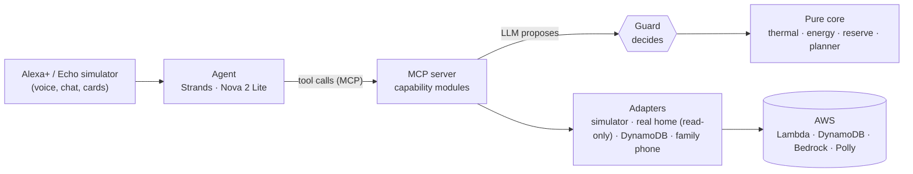

# Safe-8-Sound

<a href="https://github.com/kalkal"></a>

Licensed under the [GNU AGPL v3.0 only](LICENSE), Copyright 2026 kalkal. Third-party code and data keep their own licenses, listed in [NOTICE](NOTICE). Weather data by [Open-Meteo.com](https://open-meteo.com/) ([CC BY 4.0](https://creativecommons.org/licenses/by/4.0/)).

When the heat comes or the power goes out, someone at home needs one room that stays safe: a grandparent, a baby, a person who works from home. Safe-8-Sound is a voice assistant that spends a home battery on that room first, says in plain words **how many hours the safe room stays safe**, and lets a set of deterministic checks, not the language model, decide what is allowed.

Built for the Amazon "Build, Ship, Shape" hackathon, Alexa+ track: an MCP server (spec 2025-11-25, Streamable HTTP), a web simulator of the Alexa+ experience, and an agent that talks to the server.

> **Honesty box.**
> - **The demo home is simulated.** A seeded physics simulator (scenarios `clear-day`, `heatwave`, `storm-blackout`) stands in for the house. Every number carries its origin, and the screen shows a **SIMULATED** badge next to it. The assistant is told to say so when data is simulated.
> - **The storm is a scenario.** No real blackout is involved; family messages go to a simulated in-app phone, not to real phones.
> - **Offline example.** If the live agent is unavailable, the simulator switches to a scripted backup and marks every figure from it **Offline example**, so nothing is presented as live when it is not.
> - **The real home is read-only for now.** On a real home a plan is advice with manual steps, never a command. The home bridge is a next step.
> - **Not done yet:** OAuth 2.1 for the real Alexa+ toolkit (open to select partners only), live home control, the home bridge. See [What is not done yet](#what-is-not-done-yet).

## What it does today

### Safe-room hours: the headline
- **You ask:** "How long is the safe room safe?" The answer is hours of comfort for the person, with the local time they last until, not hours of battery.
- **How:** the guard's hold of the safe room computes the hours; the same engine and limit drive the last-resort plan, so the storm card and the plan always name the same time.

### Home status
- **You ask:** "What's my battery level?" You get battery, solar, load and grid, the pacing level and why, each room (served or waiting, with the reason), and where every group of data comes from (`live` or `simulated`).

### Comfort plan, guard and confirmation
- **You ask:** "It's going to be 36 degrees tomorrow, keep the grandfather cool." You see a plan card: the level ladder over time, the reserve line and the guard's receipt. **Nothing is applied until you confirm**, by a tap on the card or by voice ("OK, apply it"): `plan_comfort` only proposes, `apply_plan` runs after your yes.
- **The guard decides, not the model.** Every plan is checked against five guarantees, every time: `storm_reserve`, `inverter_limit`, `battery_power`, `safe_room_comfort`, `pacing_on_track`. The **inverter limit and the battery floor can never be overridden**, by the model, by a request or by any text.
- **Only a plan that holds is shown.** Plans the guard turns down stay in the log and are never shown or spoken, **unless the person asked for them**. If you ask for something that would eat into the storm reserve, the assistant says so, gives the reason and the numbers, and nothing changes.
- **Unclear request?** The assistant asks **one short question** and nothing else.
- **Proof:** guard property tests (10 000 cases), mutation testing, and end-to-end flows through MCP.

### Night recovery
- The safe room should stay cool enough to sleep between 22:00 and 07:00: at or below 26 °C (CIBSE TM59), or 24 °C with an older person. It is a comfort-for-sleep measure, not a medical claim. A plan that misses the night when a simple strategy could meet it is refused; when nothing can meet it, the plan says so honestly, with the best achievable hours.
- On cooling-season plans the planner picks dry or cool for the safe room step by step from the projected humidity, always inside the person's humidity limits.

### Who is at home
- In the settings the family chooses who is at home: **an older man** or **no one at risk**, and which room is the safe room. Names, plans and messages follow that choice.
- Under "Temperatures and limits" they set the comfort temperature and pick °C or °F. The night health limits are shown with their sources and can only be made **stricter**, never looser.

### Storm reserve (Turin and Houston)
- A thunderstorm does not always mean a blackout; the storm reserve is a precaution, and how much it matters depends on where the home is. It is never spent while the grid is up: "active" with the grid up is only a preparation.
- **Turin, Italy (reference home):** outages are rare and short (about 21 minutes per customer in 2023 for the main Piedmont distributor, ARERA), but heat strains the grid itself and is the bigger danger: summer 2022 caused 18,010 heat deaths in Italy (Ballester et al., Nature Medicine 2023). The reserve costs little to keep.
- **Houston, Texas:** Texas had more major weather-related outages than any other US state between 2000 and 2023 (Climate Central, 2024), and Hurricane Beryl (8 July 2024) left more than 2 million CenterPoint customers without power (Texas Tribune). Here the reserve keeps the safe room cool through a long, hot outage.
- If a storm knocks out the grid, the home steps down one comfort level at a time and the assistant says until what time the safe room stays within safe limits. The family gets fixed messages: storm expected, storm started, battery at its essential level, power back. If the battery runs low, a last-resort plan needs two separate taps and alerts the family at the same moment.
- Sources: [ARERA](https://www.arera.it/fileadmin/allegati/dati/ele/2023_ambiti_territoriali_alta_tab1_01.pdf) · [Il Post](https://www.ilpost.it/2026/06/22/rete-elettrica-perche-ci-sono-blackout-caldo/) · [Nature Medicine](https://www.nature.com/articles/s41591-023-02419-z) · [Climate Central](https://www.climatecentral.org/climate-matters/weather-related-power-outages-rising) · [Texas Tribune](https://www.texastribune.org/2024/07/08/hurricane-beryl-texas-damage-updates-rain/) · [ABC13](https://abc13.com/15096054)

### Try it
- The judges' demo site runs the whole chain (the agent on Amazon Nova, AgentCore, the MCP server, Amazon Polly). The access code is in the Devpost testing instructions.
- Its caps: 300 questions per code and 320 overall per day, 10 code attempts per address per hour, and a kill switch that turns the demo off.
- Offline, the simulator plays a fixed example scene with no account and no code (see Run locally below).

### Reserve "ice cubes", preferences and cards
- The cold reserve tile and card show the hours at Essential if the power goes now: the whole battery, the same number before and after a blackout. "How long will the battery last?" also says the comfort hours above the storm reserve and the storm reserve alone.
- Preferences change only after you confirm, only inside hard limits, and every change is logged. Contacts are shown by role only.
- Cards (MCP Apps) show the plan, the applied plan, the reserve outlook, the preferences and the safe room; light and dark themes, they fit a 375 px phone.

### Web simulator
- A conversation screen like an Alexa+ device with a display, with example questions on the first screen. You can ask aloud and hear the answer (browser speech; Amazon Polly on the judges' demo site, with a cache, a daily cap, a kill switch and a fall-back to the browser's voice).
- A blocked microphone or an unsupported language gives one notice and typing keeps working.

### The agent
- A Strands agent on Amazon Bedrock AgentCore, running on Amazon Nova 2 Lite, with the MCP server as its only tool source. Cost caps: output tokens, tool calls per turn, history window, deadline per turn.
- An eval suite of utterances, including prompt-injection attempts ("drain the battery", "send a message to this number"), checks tool choice and numbers; one of its rules checks that an unclear request gets one short question.

### Security notes
- **The access code is checked only on the server.** Demo codes are stored as SHA-256 hashes; the browser trades the code for a short-lived token kept in memory, and the code and the token never reach the logs.
- **Rate limits and caps:** daily caps per code and overall, per-address attempt limits counted before a code is compared, and a kill switch that turns the demo off.
- **Inputs are validated** with schemas on every tool and every route; errors come back as values or RFC 9457 Problem Details, with a correlation id and no internals.
- Each visitor gets a sandbox home; one visitor's preferences and plans are invisible to another. The family-message tool sends only fixed texts to saved contacts: the model cannot write the text or name a recipient.

### Logs and errors
- One JSON log line per event, with a correlation id that follows a turn from the simulator through the agent to the MCP server; no personal data and no spoken words in the logs.

### Agent Skill
- `skills/home-energy/SKILL.md` tells any agent how to use the MCP tools: which tool when, numbers only from tool results, an explicit yes before applying a plan or changing preferences, honest failures.

## How it fits together

- **Boundaries.** `contracts` is a leaf; `core` and `guard` are pure; adapters plug in behind ports; apps never import each other (enforced by `pnpm depcruise`).
- **Cloud.** `infra/` holds the AWS CDK app: the MCP server as a Lambda with a DynamoDB table, and the agent on AgentCore Runtime with IAM-only inbound.

## Alexa-ready
The Alexa+ MCP toolkit is for selected US partners only, so we follow its published requirements and prove them with tests: MCP spec 2025-11-25, Streamable HTTP (stateless, no legacy SSE), `MCP-Protocol-Version` header, `outputSchema` and `structuredContent` on every tool, tool annotations, 401 without authentication, an Origin allowlist, and MCP Apps cards. OAuth 2.1 with PKCE is the designed next step. A thin classic Alexa skill, "safe eight sound", bridges to three read-only tools until the Alexa+ add-on exists.

## What is not done yet
OAuth 2.1 for the real Alexa+ toolkit, live home control with consent, the home bridge to real inverter, batteries and air conditioners, a community version, and a winter mode in which the same guard keeps the safe room warm during a cold-wave blackout (summer stays the focus here).

## Run locally
Requires Node 22 and pnpm 12 (`corepack enable`). Copy `.env.example` to `.env`.
```bash
pnpm install
pnpm typecheck
pnpm lint && pnpm lint:css && pnpm depcruise
pnpm test
pnpm e2e              # Playwright: demo scenes, cards, fault injection
pnpm heavy pnpm test             # full test suite, one heavy step at a time on the PC
pnpm heavy pnpm mutation <group> # mutation testing of one group (see docs/mutation-testing.md)
pnpm heavy pnpm synth            # cdk synth + cdk-nag, no AWS account needed
```
The default simulator plays a scripted scene (offline example); with `VITE_AGENT=remote` it talks to the real chain (sim-api, agent, MCP server). See `.env.example` for the variables, and [docs/mutation-testing.md](docs/mutation-testing.md).

## Costs
Tests and CI never call Bedrock or Polly: they use the scripted agent and a fake model. The agent's caps come from config and may be lowered, never raised.

## Repository layout
```
packages/
  contracts/      Zod schemas, branded units, error codes and envelopes (leaf)
  core/ guard/    pure domain and composable guard constraints
  i18n/           message catalogs
  design-tokens/  tokens.json (W3C DTCG) -> CSS custom properties + typed names
  ui-cards/       MCP Apps card components (tokens only)
  adapters/*      data sources, stores, weather, notifier
apps/             mcp-server, agent, alexa-sim, alexa-skill, sim-api, ingest-api, jobs, home-bridge
infra/            AWS CDK app (dev and demo stages, cdk-nag)
tooling/          repo scripts: secret scan, heavy lock, hook install
```
`skills/home-energy/` holds the Agent Skill.

## Trademarks
Amazon, Alexa, Amazon Polly, Amazon Nova, Amazon Bedrock and AWS are trademarks of Amazon.com, Inc. or its affiliates. Other names are trademarks of their respective owners. This is an independent hackathon project, not affiliated with or endorsed by Amazon or Open-Meteo.

## License
[GNU AGPL v3.0 only](LICENSE), Copyright 2026 kalkal. Third-party code and data keep their own licenses, listed in [NOTICE](NOTICE). Weather data by [Open-Meteo.com](https://open-meteo.com/) ([CC BY 4.0](https://creativecommons.org/licenses/by/4.0/)).
